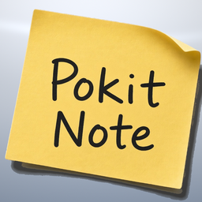

<h1>
&nbsp; &nbsp; Pokit Note Claude Plugin
</h1>

This is the Claude plugin for Pokit Note (pronounced 'Pocket Note'). Pokit Note enables collaboration with Claude from your phone on to-do lists, shopping, notes, recipes and more.

Pokit Note is currently only available for iPhone, and only in the US. Android support coming soon.

## Install in Claude Code

1. **Install the plugin.** In Claude Code, run:

   ```
   /plugin install pokit-note --marketplace botrelay-ai/pokitnote-claude-plugin
   ```

   On Claude Code versions before 2.1.275, add the marketplace first, then install:

   ```
   /plugin marketplace add botrelay-ai/pokitnote-claude-plugin
   /plugin install pokit-note@pokit-note
   ```

2. **Sign in.** Run `/mcp`, choose **pokitnote**, and choose **Authenticate**. The Pokit Note website opens in your default browser. If you don't already have an account, create one, then sign in and choose **Approve**. You can also run `/pn-sign-in` for these steps.

3. **Try it.** Ask Claude something like "What's on my grocery list?" or "Add oat milk to my shopping list."

## Use Pokit Note in the Claude App

To use Pokit Note in Claude on the web, the desktop app, or the iPhone app, add it as a connector. Open **Settings**, then **Connectors**, choose **Add custom connector**, and enter `https://pokitnote.com/mcp`. Then choose **Connect**, sign in to Pokit Note, and choose **Approve**.

The connector is also what lets Claude handle what you share from your phone, below.

## Share From Your Phone With Claude

Connect the Pokit Note app to a Claude routine to share links and photos with Claude and get notices when you change a list, note, or recipe. A routine is a saved Claude task that runs in the cloud whenever Pokit Note calls it. Routines need a Claude Pro, Max, Team, or Enterprise plan with Claude Code on the web.

1. **Add the Pokit Note connector** to your Claude account, as described in [Use Pokit Note in the Claude App](#use-pokit-note-in-the-claude-app).
2. **Create a routine** at [claude.ai/code/routines](https://claude.ai/code/routines). For its prompt, paste the full contents of [`routine-prompt.md`](routine-prompt.md) from this repository. Include the Pokit Note connector.
3. **Add an API trigger.** In the routine, under its triggers, add an **API** trigger and choose **Generate token**. Copy the URL and the token. The token is shown only once. If you lose it, generate a new one, which replaces the old one.
4. **Connect the app.** In the Pokit Note app on your iPhone, open Account, then Connected Assistant, and choose Claude. Paste the URL and the token, tap Save, then tap Send Test. The routine runs and confirms it got the test. You can see each run at [claude.ai/code](https://claude.ai/code).

Keep the token private. Paste it only into the Pokit Note Connected Assistant screen.

A routine accepts up to 30 runs an hour, and your account up to 100, and each run uses your Claude plan's usage. Every share and every change notice is a run. If you edit a lot on your phone, turn off change notices for items Claude doesn't need to watch.

## Address

Leave Pokit Note address unset for normal use. The connector uses https://pokitnote.com/mcp with no trailing slash.

The address is the optional `POKITNOTE_API_BASE` environment variable. Set it before you start Claude Code only when you are pointing the connector at a different Pokit Note server, and omit any trailing slash.

## Subscription

Assistant setup and Send Test work right away. Every new account gets 7 days of full access. After that, editing, sharing, and change notices need the free trial (free for the first month) or a subscription ($29.99/year through the App Store). Without one, the account is read-only.

## Lists

A list is a List, a Checklist, or a Grocery Shopping list. Claude can create one and can change its name, color, icon, completed items, and lines. Completed items can stay crossed off or be hidden. Claude can add items and change an item's name, checked state, note, flag, due date, urgent alarm, and the item it sits under. A flag marks an item as important. A due date is a day, or a day and a time. An urgent alarm rings on your phones at that time, and it needs a due date with a time.

A Grocery Shopping list groups items by aisle. The aisles are Fresh Produce, Meat and Fish, Pharmacy, Bakery, Flower Shop, Wine & Beer, Breakfast & Cereal, Baking & Spices, Canned Goods & Soup, Pasta, Rice & Sauces, Condiments, International, Snacks & Crackers, Beverages, Coffee & Tea, Dairy & Eggs, Frozen Foods, Pet Food, and Other. Coffee beans, ground coffee, K-cups, and tea go in Coffee & Tea, not Beverages. Dog and cat food, treats, and litter go in Pet Food.

The list type stays as it was when the list was created. Items can sit in named groups, such as This week. Claude uses a group only when you ask for one or the list already has it, and uses aisles on a Grocery Shopping list.

Checked items you clear from a Grocery Shopping list stay under Recently Bought for 90 days. Claude can put one back on a list. Claude asks you before clearing items or deleting anything.

Claude can catch up on recent changes to your notes, lists, and recipes.

## Recipes

Claude can create a recipe and change it. A recipe has a name, notes, instructions, a color, and an icon. An ingredient has a name, a quantity, a measurement, and can sit in a group and an aisle. Ingredients can be checked off, and Claude can add a recipe's ingredients to a grocery list in one step. Steps are the ordered method.

## Notes

Ask Claude to create a note or change one. A note has a title and text.

## How to Collaborate With Claude

- Share links and photos from the iPhone share sheet with a prompt, as shown below.
- Claude gets a notice when you change a list, note, or recipe. Turn notices off for one item in its Info, or for everything in Connected Assistant settings.

In Safari, Photos, or any app, tap Share, choose Pokit Note, pick a quick prompt or type your own, and tap Send. Claude handles it and tells you what it did.

- Recipe page: "Get the recipe from this page and add it to my recipes." Claude saves it to Recipes with the ingredients sorted into grocery aisles, plus the steps.
- Article: "Summarize this page and create a note." You get a new note with a short summary and the link.
- Product page: "Add the item on this page to my shopping list." It goes on your grocery list in the right aisle.
- Photo of a dish: "Find the best recipe for this dish and add it to my recipes."
- Photo of something you're out of: "Identify this and add it to my shopping list."

Shared photos are stored privately and deleted after 7 days.

## Turn a Recipe Into a Shopping List

Ask Claude in plain words:

- "Add the ingredients for Chicken Marsala to my Shopping list."
- "Add everything for Stuffed Bell Peppers to my grocery list except the rice."
- "I'm making Banana Bread and Chicken Marsala this weekend. Put what I need on my Shopping list."

Ingredients land in the right aisle with their amounts, like "Flour (2 cup)". Anything already on the list and not checked off is skipped, so adding the same recipe twice doesn't create duplicates. Claude tells you what it added and what it skipped.

## For Developers

- `routine-prompt.md` is generated from the two skills. After editing a skill, run `python3 scripts/build_routine_prompt.py`.
- `python3 scripts/validate_plugin.py` checks the manifests, the MCP config, and the skills. `python3 -m unittest discover -s tests` runs the tests. CI runs both, plus `claude plugin validate`.
- [docs/claude-integration.md](docs/claude-integration.md) lists what the Pokit Note server and iPhone app need for Claude sign-in and Claude routines.

## Links

- Support: https://pokitnote.com/support
- Privacy: https://pokitnote.com/privacy
- Terms: https://pokitnote.com/terms
