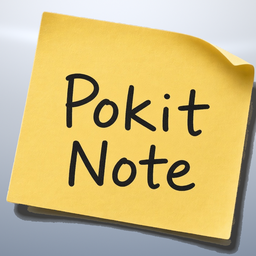

<h1>
&nbsp; &nbsp; Pokit Note Claude Plugin
</h1>

This is the Claude plugin for Pokit Note (pronounced 'Pocket Note'). Pokit Note enables collaboration with Claude from your phone on to-do lists, shopping, notes, recipes and more.

Pokit Note is currently only available for iPhone, and only in the US. Android support coming soon.

## Install the Plugin
1. Install the plugin in the cloud by logging in at claude.ai/customize/plugins
2. Select Plugins, click + Add, and choose Add marketplace.
3. Choose Add from a repository.
4. Paste the following: https://github.com/botrelay-ai/pokitnote-claude-plugin
5. Turn on Sync Automatically, and click the Sync button.
6. Click Add next to the Pokit Note plugin.

## Authorize Pokit Note
1. After the Pokit Note plugin is added, click on it to open its settings.
2. Click on the Connectors tab.
3. Click the Connect button.
4. If prompted to verify the Pokit Note server (https://pokitnote.com/mcp), click Continue. And if prompted, set the Authentication method to _Sign in now_ and the OAuth client to _Use Claude's published identity_, and click _Add_. On the pokitnote.com website, log into your account and click the Approve button to give Claude full access to your notes, lists and recipes.

## Create a Cloud Routine
This routine will be called whenever you want to share an image, text, or URL with Claude and have it create a note, list, or recipe in Pokit Note.
1. Open claude.ai/code/routines
2. Under Code click Scheduled to set up a routine task.
3. Click New Task on the right and choose Set up manually.
4. Enter Pokit Note Connector for the Name
5. Copy the instruction text found in [docs/routine-prompt.md](https://github.com/botrelay-ai/pokitnote-claude-plugin/blob/main/docs/routine-prompt.md) and paste it into the Instruction text box.
6. Set the Trigger to API.
7. Click Save and copy the generated API key.

## Configure the App
1. In the Pokit Note app on your phone, set the API Key. Paste the routine's API key you copied at the end of the previous step into the API Key field.
2. Set the URL. From your browser, copy the routine's webhook URL by locating API under Triggers and clicking the copy symbol next to it. Paste it into the Trigger URL field on your phone.
3. From the Connect Your AI Assistant wizard on your phone, the last step is Send a Test. Click the Send a Test button to send a test message to the routine. If it's configured correctly, you'll see the message: 'Claude received your test message.'

## How to Collaborate With Claude
In Safari, Photos, or any app, tap Share, choose Pokit Note, pick a quick prompt or type your own, and tap Send. Claude handles it and tells you what it did.

- Recipe page: "Get the recipe from this page and add it to my recipes." Claude saves it to Recipes with the ingredients sorted into grocery aisles, plus the steps.
- Article: "Summarize this page and create a note." You get a new note with a short summary and the link.
- Product page: "Add the item on this page to my shopping list." It goes on your grocery list in the right aisle.
- Photo of a dish: "Find the best recipe for this dish and add it to my recipes."
- Photo of something you're out of: "Identify this and add it to my shopping list."

Shared photos are stored privately and deleted after 7 days.

## Turn a Recipe Into a Shopping List

Ask Claude in plain words:

- "Add the ingredients for Chicken Marsala to my Shopping list."
- "Add everything for Stuffed Bell Peppers to my grocery list except the rice."
- "I'm making Banana Bread and Chicken Marsala this weekend. Put what I need on my Shopping list."

Ingredients land in the right aisle with their amounts, like "Flour (2 cup)". Anything already on the list and not checked off is skipped, so adding the same recipe twice doesn't create duplicates. Claude tells you what it added and what it skipped.

## Links

- Support: https://pokitnote.com/support
- Privacy: https://pokitnote.com/privacy
- Terms: https://pokitnote.com/terms
